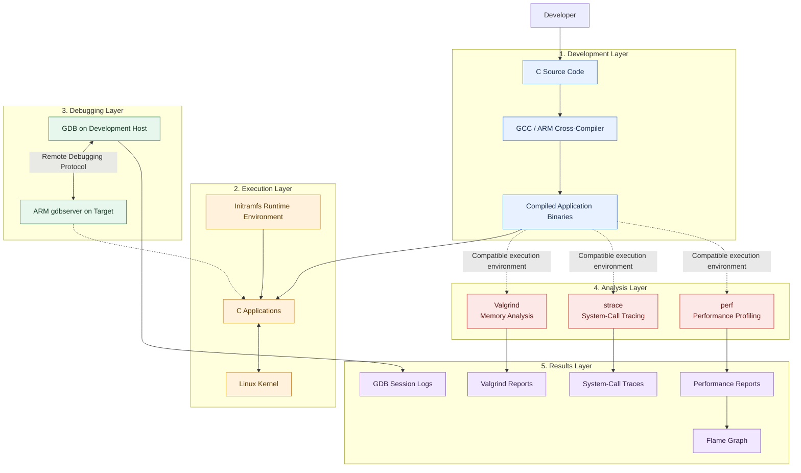
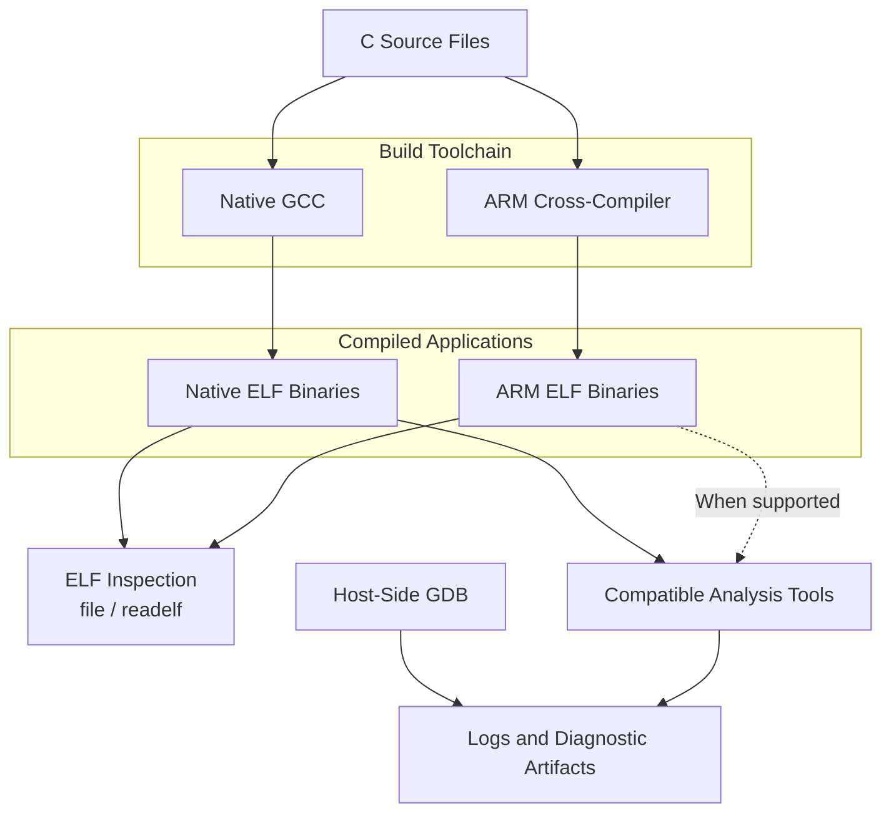
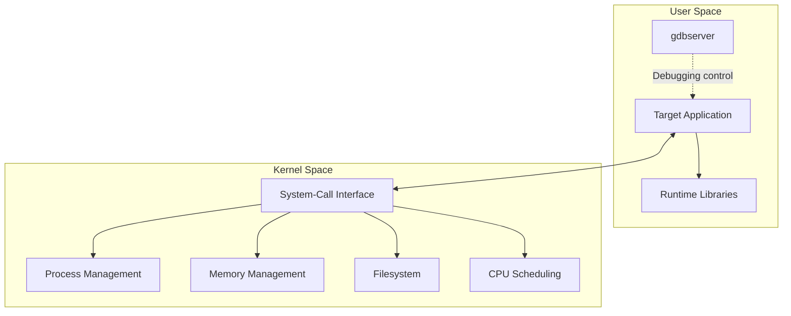
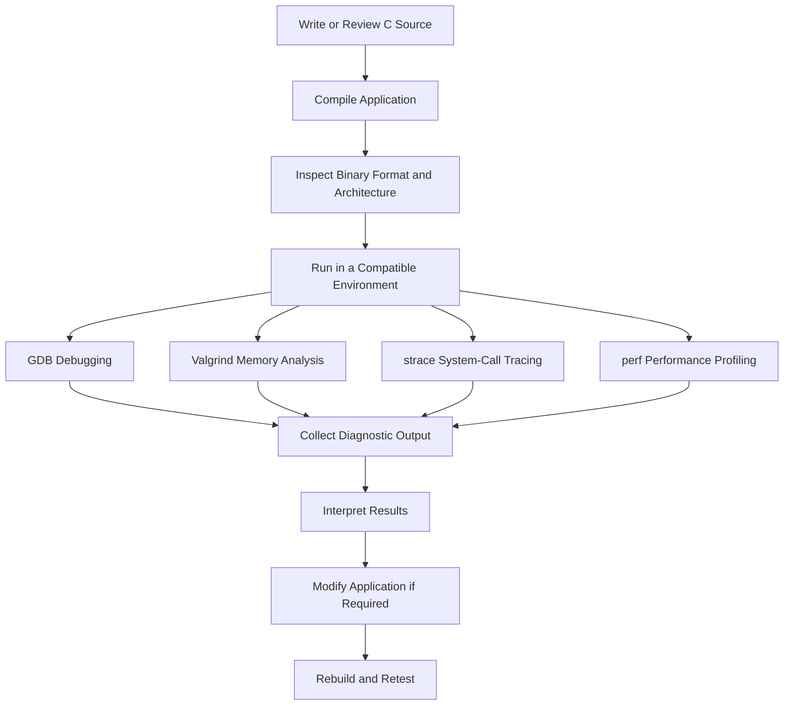
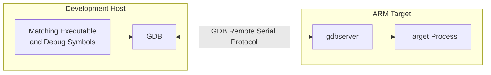
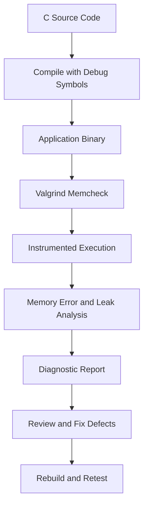
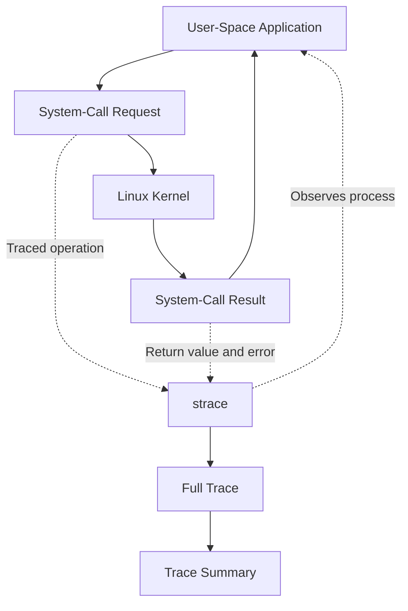
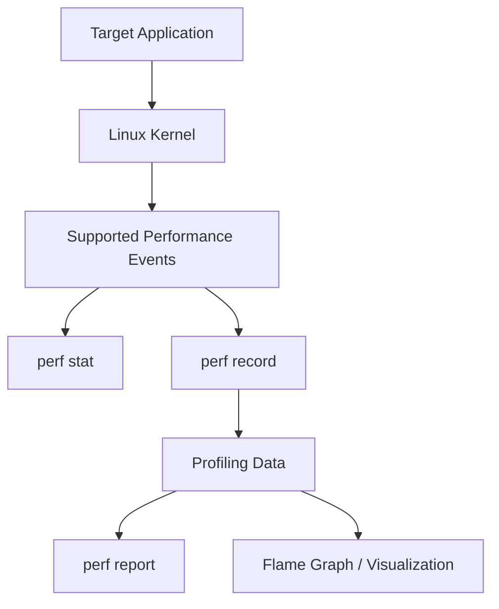

# Embedded Linux Lab 3 — Debugging, Memory Analysis & Performance Profiling

<p align="center">
  <strong>Embedded Linux · ARM · GDB · Valgrind · strace · Linux perf</strong>
</p>

<p align="center">
  
  
  
  
  
</p>

---

## Table of Contents

- [1. Project Overview](#1-project-overview)
- [2. System Architecture](#2-system-architecture)
  - [2.1. High-Level Architecture](#21-high-level-architecture)
  - [2.2. Development Host Architecture](#22-development-host-architecture)
  - [2.3. Embedded Linux Target Architecture](#23-embedded-linux-target-architecture)
  - [2.4. Application Execution and Analysis Workflow](#24-application-execution-and-analysis-workflow)
- [3. Debugging and Analysis Tools](#3-debugging-and-analysis-tools)
  - [3.1. GDB and gdbserver](#31-gdb-and-gdbserver--remote-debugging)
  - [3.2. Valgrind](#32-valgrind--memory-analysis)
  - [3.3. strace](#33-strace--system-call-tracing)
  - [3.4. Linux perf](#34-linux-perf--performance-profiling)
- [4. Project Structure](#4-project-structure)
- [5. Build and Environment Inspection](#5-build-and-environment-inspection)
- [6. Results and Analysis](#6-results-and-analysis)
- [7. Technical Considerations](#7-technical-considerations)
- [8. References](#8-references-and-further-reading)
- [9. Skills Demonstrated](#9-skills-demonstrated)
- [10. Repository Maintenance](#10-repository-maintenance)
- [11. Conclusion](#11-conclusion)

---

## 1. Project Overview

Embedded Linux Lab 3 focuses on application debugging, memory-error detection, system-call tracing, and performance profiling in an Embedded Linux development environment.

The project uses C applications to investigate software defects and explore interactions between user-space programs, debugging tools, and the Linux kernel.

It also includes a custom-built ARM-compatible `gdbserver` binary and a generated initramfs archive for the lab environment.

### Key Objectives

- Debug C applications using GDB.
- Understand remote debugging between a development host and an ARM target.
- Investigate memory-management issues using Valgrind.
- Trace system calls and process behavior using strace.
- Collect and analyze application performance data using Linux perf.
- Inspect executable formats and target architectures.
- Organize source code, executables, diagnostic reports, and runtime artifacts in a structured repository.

### Project Scope

| Area | Description |
|---|---|
| Application development | C source code and executable applications |
| Debugging | GDB-based execution inspection |
| Remote debugging | ARM `gdbserver` and host-side GDB |
| Memory analysis | Valgrind diagnostics and before/after comparison |
| System-call tracing | strace output and trace analysis |
| Performance profiling | perf statistics, profiling reports, and visualization |
| Runtime environment | Embedded Linux and initramfs artifacts |
| Documentation | Technical reports and reproducible project organization |

## 2. System Architecture

### 2.1. High-Level Architecture

The following diagram presents the overall architecture of Embedded Linux Lab 3, from source-code development and compilation to target execution, debugging, analysis, and artifact collection.



#### Architecture Layers

| Layer | Responsibilities | Main Components |
|---|---|---|
| Development Layer | Develop and compile application source code. | C, GCC, ARM cross-compiler |
| Execution Layer | Execute applications in a compatible Linux environment. | Application binaries, initramfs, Linux kernel |
| Debugging Layer | Inspect application execution and debug remote target processes. | GDB, ARM `gdbserver` |
| Analysis Layer | Investigate memory behavior, system calls, and performance. | Valgrind, strace, perf |
| Results Layer | Preserve diagnostic information for analysis and documentation. | Debug logs, memory reports, traces, profiling reports, flame graph |

**Architecture note:** This is a logical system overview. Valgrind, strace, and perf do not necessarily run on the same machine or against the same binary. Their execution location depends on architecture compatibility, installed tool support, and the lab configuration.

### 2.2. Development Host Architecture

The development host provides the environment for source-code editing, compilation, executable inspection, debugging control, and result analysis.



The host-side workflow includes:

1. Maintaining the C source files.
2. Compiling applications for the intended execution architecture.
3. Inspecting ELF headers and executable formats.
4. Configuring the host debugger for the target architecture.
5. Connecting GDB to a compatible remote target.
6. Reviewing diagnostic output and saving experiment results.

A native x86-64 executable and an ARM executable may require different execution environments. Cross-compilation alone does not make a target binary directly executable on the host.

### 2.3. Embedded Linux Target Architecture

The target environment contains the application process, the Linux kernel, and any runtime components required by the application.



#### User Space

The application runs as a user-space process. It uses runtime libraries and requests operating-system services through system calls.

`gdbserver` is a user-space debugging service. It is not a kernel module and does not replace the Linux kernel.

#### Kernel Space

The Linux kernel provides process management, virtual memory, filesystem operations, scheduling, and other system services.

Tools such as strace help observe selected interactions between an application and the kernel. Linux perf can collect supported performance events associated with application and kernel activity.

#### Initramfs

The initramfs archive packages files used to establish a runtime filesystem for the lab.

The available applications, libraries, shell utilities, initialization scripts, and debugging components depend on the actual archive contents.

The presence of an initramfs archive does not by itself establish which programs are available inside it; inspect the archive to verify its contents.

### 2.4. Application Execution and Analysis Workflow

The workflow below illustrates the general lifecycle of an application during the lab.



The tools serve complementary purposes. GDB investigates program execution state, Valgrind examines supported memory operations, strace observes system calls, and perf collects performance information.

The workflow may be repeated after fixing a defect or changing the application.

## 3. Debugging and Analysis Tools

### 3.1. GDB and gdbserver — Remote Debugging

#### Architecture

GDB and `gdbserver` implement a client–server debugging model.



**GDB responsibilities:**

- Load executable files and debug symbols.
- Set breakpoints and supported watchpoints.
- Inspect variables and memory.
- Examine call stacks and program state.
- Control program execution.
- Present source-level debugging information.

**gdbserver responsibilities:**

- Start or attach to a target process, depending on the supported configuration.
- Establish a remote-debugging endpoint.
- Receive debugging requests from GDB.
- Control the target process through the supported debugging interface.
- Return execution state and debugging information to the host.

The host debugger and target server communicate using the GDB Remote Serial Protocol over a supported transport, such as TCP or serial.

#### Project Artifact

```text
apps/gdbserver_armhf
```

The project retains a custom-built ARM-compatible `gdbserver`.

| Property | Recorded Information |
|---|---|
| Artifact | `apps/gdbserver_armhf` |
| File format | ELF executable |
| Target architecture | ARM 32-bit |
| ABI designation | ARM hard-float (`armhf`) |
| Linkage | Statically linked |
| Recorded file size | 1,408,680 bytes |
| Purpose | Remote debugging of compatible target applications |

The exact GDB version, build options, and supported target features should be confirmed from the original build log or binary. The filename alone does not prove ABI compatibility or static linkage; verify those properties against the actual artifact.

#### Inspect the Binary

From the project root:

```bash
file apps/gdbserver_armhf
readelf -h apps/gdbserver_armhf
readelf -l apps/gdbserver_armhf
```

To inspect available dynamic dependencies:

```bash
readelf -d apps/gdbserver_armhf
```

A statically linked executable normally does not contain the usual dynamic dependency entries, although ELF inspection and actual target testing are still needed to establish compatibility.

#### Example Remote Debugging Workflow

On the target, start the server with an application:

```bash
gdbserver 0.0.0.0:2345 ./buggy_app
```

On the host, load the corresponding executable:

```bash
gdb ./buggy_app
```

At the GDB prompt:

```gdb
target remote TARGET_IP:2345
break main
continue
```

Replace `TARGET_IP` with the actual target address.

For meaningful source-level debugging, the host-side executable and its debug symbols should correspond to the binary running on the target. The host GDB build must also support the target architecture.

These commands illustrate the workflow. The actual paths, server options, network configuration, and GDB build depend on the environment.

**Security:** Do not expose `gdbserver` to an untrusted network. Remote debugging can provide substantial control over the target process with the privileges of the server.

**Relevant files:**

- `apps/gdbserver_armhf`
- `apps/buggy_app`
- `apps/buggy_app.c`
- `apps/gdb.txt`
- `logs/gdb_session.txt`

### 3.2. Valgrind — Memory Analysis

#### Architecture

Valgrind provides a dynamic binary instrumentation framework. Its Memcheck tool monitors supported memory operations to detect memory errors and investigate leaks.



Valgrind can help investigate:

- Invalid memory reads and writes.
- Use of uninitialized values.
- Invalid frees and related memory-management errors.
- Memory leaks and allocation paths.
- Differences in diagnostic output before and after a fix.

Debug symbols improve the usefulness of source-level stack traces.

#### Example Commands

Compile the native application with debug information:

```bash
gcc -g -O0 -Wall -Wextra \
    apps/leaky_app.c \
    -o apps/leaky_app
```

Run Memcheck:

```bash
valgrind \
    --leak-check=full \
    --show-leak-kinds=all \
    --track-origins=yes \
    ./apps/leaky_app
```

Run the fixed implementation:

```bash
valgrind \
    --leak-check=full \
    --show-leak-kinds=all \
    --track-origins=yes \
    ./apps/leaky_app_fixed
```

These examples assume that the installed Valgrind supports the architecture of the executable. They are not guaranteed to work on ARM binaries from an arbitrary x86-64 host.

#### Project Artifacts

| File | Purpose |
|---|---|
| `apps/leaky_app.c` | Original memory-analysis example source. |
| `apps/leaky_app` | Compiled original application. |
| `apps/leaky_app_fixed.c` | Modified application source. |
| `apps/leaky_app_fixed` | Compiled modified application. |
| `logs/valgrind_report.txt` | Original memory-analysis report. |
| `logs/valgrind_fixed.txt` | Additional output from the fixed-program analysis. |
| `logs/valgrind_fixed_report.txt` | Report used to compare the modified implementation. |

The comparison should examine actual error counts, leak summaries, error categories, and allocation stack traces. The existence of a fixed-program report does not prove that all defects have been resolved.

### 3.3. strace — System-Call Tracing

#### Architecture

strace observes system calls and signals associated with a process. On Linux, it commonly uses the `ptrace` mechanism to monitor process behavior.



strace helps investigate the boundary between user space and kernel space.

It can reveal:

- File and directory operations.
- File-descriptor management.
- Process creation and termination.
- Signals delivered to a process.
- Failed system calls and error codes.
- The order and timing of selected system-call operations.

strace complements source-level debugging by showing operating-system interactions that may not be apparent from the source code alone.

#### Example Commands

Save a full system-call trace:

```bash
strace -o logs/strace_full.txt ./apps/buggy_app
```

Summarize system-call statistics:

```bash
strace -c ./apps/buggy_app
```

Trace file-related system calls:

```bash
strace -e trace=file ./apps/buggy_app
```

These commands are examples and should be adapted to the intended application and execution environment.

#### Project Artifacts

| File | Purpose |
|---|---|
| `logs/strace_full.txt` | Detailed system-call trace. |
| `logs/strace_summary.txt` | Summarized trace output. |

When reviewing the output, look for unexpected file access, repeated operations, failed system calls, and differences between expected and observed application behavior.

### 3.4. Linux perf — Performance Profiling

#### Architecture

Linux perf uses the Linux performance events infrastructure to collect performance statistics and profiling data.

Depending on hardware, kernel configuration, permissions, and tool support, it can use hardware counters, software events, and tracepoints.



**`perf stat`** collects summary statistics for a workload.

**`perf record`** records profiling samples or events for later analysis.

**`perf report`** helps inspect recorded profiling data and identify functions or code paths associated with collected samples.

A flame graph can visualize sampled execution stacks when suitable profiling data and a compatible visualization workflow are available.

#### Example Commands

Collect performance statistics:

```bash
perf stat ./apps/perf_target
```

Record profiling data:

```bash
perf record -g -- ./apps/perf_target
```

Review the profiling data:

```bash
perf report
```

These commands are illustrative. They do not establish that the commands were successfully executed in the current lab environment.

#### Project Artifacts

| File | Purpose |
|---|---|
| `apps/perf_target.c` | Source code for the profiling workload. |
| `apps/perf_target` | Compiled profiling target. |
| `apps/perf_target_arm` | ARM-target application binary. |
| `logs/perf_stat.txt` | Collected performance statistics. |
| `logs/perf_report.txt` | Performance profiling report. |
| `logs/flamegraph.svg` | Flame graph visualization artifact. |
| `logs/plot_latency.gnuplot` | GNUplot script for latency-related visualization. |

#### Interpreting Performance Results

Performance measurements depend on the execution environment.

Important factors include:

- CPU architecture and frequency.
- Kernel version and configuration.
- Available hardware and software performance events.
- Process scheduling and background workloads.
- Permissions and `perf_event_paranoid` settings.
- Workload duration and measurement repeatability.

If hardware performance counters are unavailable, document that limitation. Wall-clock timing can still be useful, but it is not equivalent to hardware-counter profiling.

## 4. Project Structure

```text
embedded_lab3/
├── apps/
│   ├── buggy_app.c
│   ├── buggy_app
│   ├── gdb.txt
│   ├── gdbserver_armhf
│   ├── leaky_app.c
│   ├── leaky_app
│   ├── leaky_app_arm
│   ├── leaky_app_fixed.c
│   ├── leaky_app_fixed
│   ├── perf_target.c
│   ├── perf_target
│   └── perf_target_arm
├── logs/
│   ├── flamegraph.svg
│   ├── gdb_session.txt
│   ├── perf_report.txt
│   ├── perf_stat.txt
│   ├── plot_latency.gnuplot
│   ├── strace_full.txt
│   ├── strace_summary.txt
│   ├── valgrind_fixed.txt
│   ├── valgrind_fixed_report.txt
│   └── valgrind_report.txt
├── output/
│   └── initramfs_lab3.cpio.gz
├── .gitignore
└── README.md
```

### Directory Responsibilities

| Directory | Description |
|---|---|
| `apps/` | C source files, compiled binaries, debugging reference material, and the custom-built ARM `gdbserver`. |
| `logs/` | Debugging transcripts, Valgrind reports, system-call traces, performance statistics, and profiling artifacts. |
| `output/` | Generated initramfs archive for the lab environment. |

## 5. Build and Environment Inspection

The following commands inspect existing artifacts. They do not rebuild the entire project.

### 5.1. Inspect Application Architectures

```bash
cd ~/embedded_lab3

file apps/buggy_app
file apps/leaky_app
file apps/leaky_app_fixed
file apps/perf_target
file apps/leaky_app_arm
file apps/perf_target_arm
file apps/gdbserver_armhf
```

Use the output to distinguish native host executables from ARM-target binaries.

### 5.2. Inspect the gdbserver ELF Header

```bash
readelf -h apps/gdbserver_armhf
```

Inspect the program headers:

```bash
readelf -l apps/gdbserver_armhf
```

Inspect dynamic-section information:

```bash
readelf -d apps/gdbserver_armhf
```

These commands help verify the file format, architecture, and linkage-related information.

### 5.3. Inspect Source Code

```bash
less apps/buggy_app.c
less apps/leaky_app.c
less apps/leaky_app_fixed.c
less apps/perf_target.c
```

Reviewing the source code helps connect the observed behavior with the application implementation.

### 5.4. Review Diagnostic Reports

```bash
less logs/gdb_session.txt
less logs/valgrind_report.txt
less logs/valgrind_fixed_report.txt
less logs/strace_summary.txt
less logs/perf_stat.txt
less logs/perf_report.txt
```

Use the recorded reports to inspect prior experiments without necessarily rerunning them.

### 5.5. Inspect the Initramfs

Check the archive:

```bash
ls -lh output/initramfs_lab3.cpio.gz
file output/initramfs_lab3.cpio.gz
```

List its contents without extracting them:

```bash
gzip -dc output/initramfs_lab3.cpio.gz | cpio -it
```

The listing shows which files are actually packaged in the archive.

## 6. Results and Analysis

The repository contains diagnostic artifacts for reviewing the different analysis workflows.

| Category | Artifact | Intended Analysis |
|---|---|---|
| Application debugging | `logs/gdb_session.txt` | Review GDB commands and debugging observations. |
| Debugging reference | `apps/gdb.txt` | Review stored GDB commands or notes. |
| Remote debugging | `apps/gdbserver_armhf` | Inspect the custom-built ARM GDB server. |
| Memory analysis | `logs/valgrind_report.txt` | Review memory diagnostics from the original analysis. |
| Memory analysis | `logs/valgrind_fixed.txt` | Inspect additional output from the fixed-program analysis. |
| Memory analysis | `logs/valgrind_fixed_report.txt` | Compare diagnostic output after modification. |
| System-call tracing | `logs/strace_full.txt` | Investigate detailed system-call activity. |
| System-call tracing | `logs/strace_summary.txt` | Review summarized trace information. |
| Performance measurement | `logs/perf_stat.txt` | Inspect collected performance statistics. |
| Performance profiling | `logs/perf_report.txt` | Review profiling information. |
| Performance visualization | `logs/flamegraph.svg` | Visualize profiling data when generated from suitable samples. |
| Runtime environment | `output/initramfs_lab3.cpio.gz` | Inspect the packaged initramfs. |

### Analysis Methodology

**GDB:** Examine execution state, stack traces, variables, and breakpoints to investigate unexpected application behavior.

**Valgrind:** Compare memory diagnostics between the original and modified programs. Inspect error categories, leak summaries, and allocation stack traces.

**strace:** Identify unexpected system calls, failed operations, and patterns in application interaction with the kernel.

**perf:** Review performance statistics and profiling samples in the context of the workload and execution environment.

The presence of a report does not by itself prove that a program is free from defects, that a fix resolved every issue, or that an optimization improved performance. Conclusions should be based on the actual diagnostic output and the conditions under which it was collected.

## 7. Technical Considerations

### Architecture Compatibility

Host and target binaries must be compatible with their execution environments. ARM 32-bit executables generally require a suitable ARM system, emulator, or compatible execution layer when run from an x86-64 host.

### Debug Symbols

Compile applications with `-g` when source-level debugging and meaningful stack traces are required.

### Valgrind Compatibility

Valgrind's architecture support depends on the installed version and execution environment. Verify support before attempting to analyze cross-compiled binaries.

### strace Permissions

Tracing may be restricted by security settings or process permissions. Output also varies with kernel behavior and the operations performed by the application.

### perf Permissions

Available performance events depend on hardware and kernel support. Restrictions such as `perf_event_paranoid` may prevent certain profiling operations.

### gdbserver Security

Remote debugging should be limited to trusted interfaces and controlled lab networks. The debugging connection can provide substantial control over the target process.

### Reproducibility

For reproducible results, document tool versions, compiler flags, architecture, kernel version, and execution configuration.

## 8. References and Further Reading

The following official resources provide documentation, command examples, and technical background for the tools used in this project.

### 8.1. GDB and Remote Debugging

1. [GNU GDB — Official Documentation](https://sourceware.org/gdb/current/onlinedocs/gdb.html/)
2. [GNU GDB — Connecting to a Remote Target](https://www.sourceware.org/gdb/current/onlinedocs/gdb.html/Connecting.html)
3. [GNU GDB — Server and gdbserver](https://www.sourceware.org/gdb/current/onlinedocs/gdb.html/Server.html)

**Recommended topics:**

- Breakpoints and stepping.
- Stack traces and variable inspection.
- `target remote` and `target extended-remote`.
- Host-side executable and debug-symbol configuration.
- Remote debugging over TCP or serial.
- Target architecture and ABI compatibility.

### 8.2. Valgrind

1. [Valgrind — Official Documentation](https://valgrind.org/docs/manual/index.html)
2. [Valgrind — Quick Start Guide](https://valgrind.org/docs/manual/quick-start.html)
3. [Valgrind — User Manual](https://valgrind.org/docs/manual/manual.html)

**Recommended topics:**

- Memcheck.
- Invalid memory accesses.
- Uninitialized memory.
- Memory leaks and leak categories.
- Debug symbols and stack traces.
- Comparing diagnostics before and after a fix.

### 8.3. strace

1. [strace — Official Website](https://strace.io/)
2. [strace — Source Repository and Documentation](https://github.com/strace/strace)

**Recommended topics:**

- System-call tracing.
- File and process operations.
- Signals and process state.
- Filtering system calls with `-e trace=...`.
- Saving traces with `-o`.
- Summarizing system-call statistics with `-c`.

### 8.4. Linux perf

1. [Linux perf — Official Documentation](https://perfwiki.github.io/main/)
2. [Linux Kernel Documentation — Workload Tracing](https://www.kernel.org/doc/html/latest/admin-guide/workload-tracing.html)
3. [Linux Kernel Source — perf Documentation](https://github.com/torvalds/linux/tree/master/tools/perf/Documentation)

**Recommended topics:**

- `perf stat`.
- `perf record`.
- `perf report`.
- Call-stack sampling.
- Hardware and software performance events.
- Kernel permissions and event availability.
- Profiling-data interpretation.

### 8.5. ELF and Binary Inspection

1. [GNU Binutils — Official Documentation](https://www.gnu.org/software/binutils/)

**Recommended topics:**

- ELF headers.
- Program headers and sections.
- `readelf` and `objdump`.
- Symbol tables.
- Static versus dynamic linkage.
- Architecture and ABI identification.

### 8.6. Embedded Linux and Initramfs

1. [Linux Kernel Documentation](https://docs.kernel.org/)
2. [Linux Kernel — Filesystems Documentation](https://docs.kernel.org/filesystems/)

**Recommended topics:**

- User space versus kernel space.
- Linux process execution.
- System calls.
- Root filesystem structure.
- Initramfs packaging and boot-time initialization.

These references are learning resources, not claims that every documented feature was exercised in the lab. The repository's source files, build artifacts, and diagnostic logs are the primary evidence for the work actually performed.

## 9. Skills Demonstrated

- Embedded Linux development.
- C programming and application debugging.
- ARM executable inspection and cross-compilation concepts.
- Remote debugging with GDB and `gdbserver`.
- Memory-error and leak analysis with Valgrind.
- Linux system-call tracing with strace.
- Performance profiling with Linux perf.
- ELF inspection with GNU Binutils.
- Initramfs artifact management.
- Diagnostic report interpretation.
- Technical documentation.
- Git-based version control and repository organization.

## 10. Repository Maintenance

The repository retains source code, selected executables, diagnostic reports, and generated runtime artifacts relevant to the lab.

The custom-built ARM GDB server is intentionally retained:

```text
apps/gdbserver_armhf
```

The GDB 12.1 source tree, source archive, temporary build directory, and downloaded Debian package are not intended to be committed as project deliverables.

This keeps the repository focused on the lab implementation and its relevant artifacts rather than duplicating large tool source trees and installation packages.

## 11. Conclusion

Embedded Linux Lab 3 brings together application debugging, memory analysis, system-call tracing, and performance profiling in a structured workflow.

The project demonstrates how different tools examine different aspects of application behavior: GDB investigates execution state, Valgrind analyzes supported memory operations, strace observes kernel interactions, and perf collects performance information.

The Host–Target architecture and custom-built ARM `gdbserver` also provide a foundation for understanding remote debugging in embedded environments.

---

**Project:** Embedded Linux Lab 3  
**Primary Language:** C  
**Platform:** Embedded Linux  
**Target Architecture:** ARM 32-bit  
**Main Tools:** GDB, gdbserver, Valgrind, strace, Linux perf, GNU Binutils  
**Focus Areas:** Debugging, Memory Analysis, System-Call Tracing, Performance Profiling
